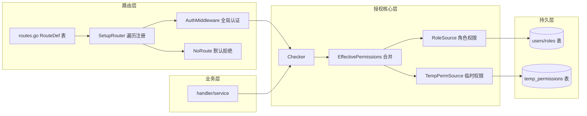

## 产品概述
对排班系统后端的鉴权/授权模块进行彻底重构，消除历史遗留的两套鉴权逻辑与角色硬编码，建立统一、可扩展、默认拒绝的权限体系。

## 核心功能需求
- **彻底更新，不向后兼容**：直接删除旧逻辑（Check() 学号猜管理员、PathPermissionMap 默认放行、IsOfficeAdmin/IsDeptAdmin 角色字符串特判、RequireAuthAndPermission 重复中间件），不留兼容层
- **单一事实来源，最小硬编码**：权限常量、角色→权限映射、路由→权限绑定各只有一处定义；路由注册改为声明式 RouteDef 表驱动
- **方案 A：权限 + 资源范围统一判定**：部门级数据访问统一走"权限 + 资源范围"（all/dept/user）判定，角色权限与临时权限一视同仁，删除角色名特判
- **临时权限作为权限来源**：抽象 PermissionSource 接口，RoleSource（角色权限）与 TempPermSource（临时权限）平级实现，Checker 统一合并为有效权限集合后判定
- **默认拒绝**：所有 /api 路径未声明权限的接口一律 403，由 NoRoute 兜底
- **统一角色体系**：合并 model/user.go 与 model/permission.go 两套角色常量，保留 IsAdmin 作为唯一内建角色短路（系统管理员拥有全部权限），其余全部走权限判定


## 技术栈选择
- 沿用现有后端技术栈：Go + Gin（gin-gonic/gin），不引入新依赖
- 数据库层面沿用现有 DAO/Model 模式，临时权限数据仍存 `temp_permissions` 表

## 实施方法
采用"从核心向外围"的重构顺序：先统一角色数据模型，再重写 auth 包判定核心（PermissionSource 抽象），随后按统一 API 替换 handler/service 全部调用点，最后把路由改为表驱动并加默认拒绝兜底，最终编译验证。由于不向后兼容，每一步直接删除旧代码，不保留兼容分支。

## 架构设计
### 系统架构
- 授权核心层（auth 包）：只负责"权限集合判定"，通过 PermissionSource 接口注入权限来源，未来新增权限来源（如 ABAC、时间段规则）只需新增一个 Source 实现
- 应用服务层（service/handler）：临时权限的授予/撤销/清理/申请审批等管理逻辑保留在此，不搬入 auth 包
- 路由声明层（router 包）：RouteDef 表集中声明"接口→权限"，SetupRouter 遍历注册并统一挂认证中间件



### 模块划分
- **auth/permissions.go**：权限常量定义（唯一"有哪些权限"）
- **auth/roles.go**：角色→权限映射表（RoleSource，唯一"谁有什么权限"）
- **auth/temp_perm.go**：TempPermSource，将 DB 有效临时授权转换为 EffectivePerm
- **auth/checker.go**：Checker 统一判定（HasPermission / HasPermissionOn / CanAccessDept / EffectivePermissions / IsAdmin）
- **auth/middleware.go**：AuthMiddleware + Authorize 系列中间件（合并原 middleware/auth.go 与 auth 包重复实现）
- **router/routes.go**：RouteDef 表（唯一"接口要什么权限"）
- **router/router.go**：表驱动注册 + NoRoute 兜底

## 目录结构
```
backend/internal/
├── auth/
│   ├── permissions.go   # [NEW] 权限常量定义（收敛原 permission.go 常量）
│   ├── roles.go         # [NEW] RoleSource + 角色→权限表（收敛 RolePermissions）
│   ├── temp_perm.go     # [NEW] TempPermSource：DB 临时授权→EffectivePerm
│   ├── checker.go       # [MODIFY] 重写：EffectivePermissions/HasPermission/HasPermissionOn/CanAccessDept，删除 IsOfficeAdmin/IsDeptAdmin/CanManageDept/CanViewDept/CanAccessPath/Check 等旧方法
│   ├── middleware.go    # [NEW] AuthMiddleware + PermissionMiddleware + PermissionOnMiddleware
│   └── permission.go    # [MODIFY] 删除 PathPermissionMap/CanAccessPath/Check()/CheckAPIAccess/CheckWithContext 等，仅保留类型与常量引用
├── middleware/
│   └── auth.go          # [MODIFY] 删除 RequireAuthAndPermission 及与 auth 包重复的 Middleware，仅保留薄封装
├── router/
│   ├── routes.go        # [NEW] RouteDef 表：声明全部接口方法/路径/handler/权限
│   └── router.go        # [MODIFY] 改为表驱动遍历注册 + NoRoute 默认拒绝，保留静态文件/开发代理逻辑
├── model/
│   ├── user.go          # [MODIFY] 删除 RoleUser 二元语义，统一角色常量
│   └── permission.go    # [MODIFY] 合并 RoleOfficeAdmin 等角色常量与 Role 模型，删除 GetSystemRoles/GetRoleDefaultPermissions 硬编码（或迁移至配置）
├── handler/
│   ├── user.go          # [MODIFY] L232/266/324/353/394 角色特判替换为权限判定
│   ├── temp_permission.go # [MODIFY] L78 替换
│   ├── application.go   # [MODIFY] L120/155/269 替换
│   ├── schedule.go      # [MODIFY] PreviewSchedule 的 CheckDeptPermission 改为统一判定
│   └── weekly_duty.go   # [MODIFY] CanPublish 调用点随 service 改造
└── service/
    ├── weekly_duty.go   # [MODIFY] L57/62/138/182 角色特判替换
    ├── temp_permission.go # [MODIFY] L74/91/106/111 替换
    └── temp_permission_application.go # [MODIFY] L264 user.Role 字符串判断改为基于权限集合
```

## 关键代码结构
```go
// 权限来源抽象（auth 包核心契约）
type PermissionSource interface {
    EffectivePermissions(p *Principal) ([]EffectivePerm, error)
}

type EffectivePerm struct {
    Permission   Permission
    ResourceType string // "all" | "dept" | "user"，空 = 不限制
    ResourceID   int
}

// 统一判定入口
func (c *Checker) HasPermission(perm Permission) bool
func (c *Checker) HasPermissionOn(perm Permission, resourceType string, resourceID int) bool
func (c *Checker) CanAccessDept(dept string) bool

// 路由声明（router 包核心契约）
type RouteDef struct {
    Method  string
    Path    string
    Handler gin.HandlerFunc
    Perm    auth.Permission // 空 = 公开接口
}
```

## 实施注意事项
- **波及面控制**：handler/service 调用点替换前，先用 code-explorer 全量扫描 `IsAdmin|IsOfficeAdmin|IsDeptAdmin|CanManageDept|CanViewDept|CanAccessPath|CheckAPIAccess|CheckWithContext|HasTempPermissionWithResource|HasTempPermissionForDept` 的引用，确保无遗漏，防止编译失败与权限漏洞
- **默认拒绝语义**：SetupRouter 中 NoRoute 需区分 `/api`（403）与前端静态资源（回退 index.html），避免破坏 SPA 路由
- **编译验证**：每完成一层立即 `go build ./...` 验证，最后统一跑 `go vet`，并以三种角色（office_admin/dept_admin/dept_member）走查关键接口


## Agent Extensions
### SubAgent
- **code-explorer**
  - 用途：全量扫描方案 A 波及的调用点（角色特判、旧鉴权函数在 handler/service/router 的全部引用），弥补当前 search_content 工具不可用导致的盲区，确保替换清单无遗漏
  - 预期结果：输出完整的"函数 → 调用文件:行号"清单，作为 handler/service 改造任务的精确依据
