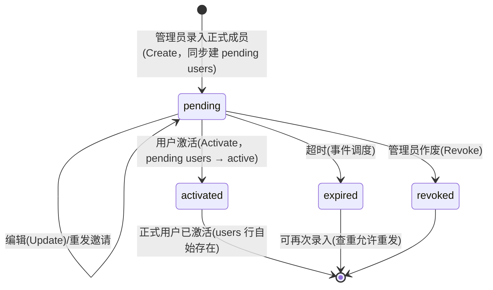

# 数据库设计文档

> 版本：v2.1（2026-08-11）
> 定位：**基于现有表结构的增量优化**（索引 / 唯一约束 / 外键 / 存储过程 / 事件调度），不改变既有业务模型与角色体系。
> 适用 MySQL 8.0+（CHECK 约束、JSON_TABLE）。
> 原则：并发与数据维护下沉数据库层；应用层只做校验与编排。

---

## 1. 现状评估（优化出发点）

现有表来自 `backend/internal/service/system.go` 建表 SQL + `migrations/003~010`，共 **15 张**。现状问题集中在**运行效率与数据完整性**，非功能缺陷：

| # | 问题 | 位置 | 影响 |
|---|---|---|---|
| 1 | `duty_records` **无唯一约束** | 同用户同时间格可重复写入 | 重复排班、统计虚高 |
| 2 | `schedule_settings` **无唯一键**，但 DAO 依赖 `ON DUPLICATE KEY UPDATE` | `admin_id` 只是普通索引 | 多管理员各自保存 → **累积多行**，`ORDER BY id DESC LIMIT 1` 只能兜底（真实 bug） |
| 3 | 高频查询**缺复合索引** | `applications`、`user_permissions_temp`、`duty_records` | 待办审批/我的申请/接口鉴权/个人周排班走全表 |
| 4 | `password_reset_tokens.token` 仅普通索引 | | 无法防重放 |
| 5 | `users` 无任职状态字段 | `is_active` 只承担账号禁用 | 无法表达在职/离职 |
| 6 | 值班次数无冗余，`COUNT(*)` 实时聚合 | `DutyDAO.BatchCountBy*` | 排班均衡/统计高频 GROUP BY |
| 7 | `user_permissions_temp.expires_at` 表允许 NULL（system.go 版），model 是非指针 `time.Time` | | 遇到 NULL `Scan` 报错（类型不一致） |
| 8 | 排班确认"先删整周再批量插"**无事务** | `ConfirmSchedule`（DeleteByWeek + CreateBatch） | 中途失败留半截数据 |
| 9 | 过期临时权限/令牌**无清理机制** | `CleanupExpiredPermissions` 依赖手动触发 | 数据膨胀、接口鉴权扫描变慢 |
| 10 | 大量写入用普通 `INSERT`，非幂等 | `DutyDAO.CreateBatch`、`AvailabilityDAO.CreateBatch` | 重复导入整批失败 |

**未改动（保留现有设计）**：
- 角色体系：`users.role` + `users.dept_role`（见 §3）
- 部门用**硬编码字符串**（办公室/竞赛部/项目部/科普部），`model.DepartmentID()` 映射，**不引入 departments 表**
- 申请审批流四表及状态机
- `availability` 已有的 `uk_avail` 唯一约束与 `idx_time_user`

---

## 2. 表清单（共 16 张 = 现有 15 − 1 + 新增 2）

| # | 表名 | 变更 |
|---|---|---|
| 1 | `system_config` | 无 |
| 2 | `users` | **变更**：+ `employment_status`（pending 待入职/active 在职/resigned 离职，取代 `is_active`）；- `is_active`、`joined_at`、`left_at` |
| 3 | `availability` | 无（已有 uk_avail / idx_time_user / FK） |
| 4 | `duty_records` | **变更**：+ 唯一约束 `uk_duty_cell`、+ 索引 `idx_user_week`、+ CHECK |
| 5 | ~~duty_counters~~ | **删除**（先备份为 `duty_counters_backup_<日期>`）；值班次数改由 `duty_records` 运行时聚合 |
| 6 | `schedule_settings` | **变更**：+ `config_key` 唯一键（单例化） |
| 7 | `export_templates` | 无 |
| 8 | `weekly_duty_assignments` | 无 |
| 9 | `user_permissions_temp` | **变更**：+ 复合索引、+ 外键、`expires_at` 统一 NULL 默认 |
| 10 | `smtp_config` | 无 |
| 11 | `password_reset_tokens` | **变更**：+ `token` 唯一索引、+ 外键 |
| 12 | `application_types` | 无 |
| 13 | `applications` | **变更**：+ 复合索引、+ 外键 |
| 14 | `application_approvals` | **变更**：+ 外键 |
| 15 | `application_approvers` | **变更**：+ 外键 |
| 16 | `leave_requests` | **新增**（请假，复用审批流） |
| 17 | `user_invitations` | **新增**（预注册待激活账号） |

---

## 3. 角色与权限体系（现有设计，保持不变）

> 关键点：**一个部门可以有多个管理员**。`dept_role` 是每用户字段，任意多用户可同时为 `dept_admin`，不存在"一个部门仅一个管理员"的限制。

### 3.1 角色解析（`auth.ResolveRole`）

```
users.role = 'admin'                                        → 系统管理员（全部权限，Checker 短路）
users.department = '办公室' AND dept_role = 'dept_admin'     → 办公室管理员 office_admin
users.dept_role = 'dept_admin'                               → 部门管理员（可多个，per 部门）
users.dept_role = 'dept_member'                              → 部门成员
其他                                                         → 普通用户 user
```

> 说明：`office_admin` 是**派生身份**而非存储角色（`users.role` 仅允许 `admin/user`），
> 由鉴权层按上述组合规则附加全局权限集（见 `auth/roles.go` 的 `officeAdminPermissions`）。
> `application_approvers.role_type` 中的 `'office_admin'` 是审批流角色类型
> （匹配"办公室部门的部门管理员"），与用户存储角色无关。

### 3.2 权限模型

- 权限来源 = **角色权限**（`auth.RolePermissions` 映射表）∪ **临时权限**（`user_permissions_temp`）
- 部门级权限（`deptScopedPermissions`）自动限定资源范围为**用户所在部门**（`resource_type=dept, resource_id=DepartmentID(department)`）
- 权限组传递展开（`schedule:manage:all` → `schedule:manage:dept` → ...）由 `permImplies` 处理
- 部门硬编码映射：办公室=1、竞赛部=2、项目部=3、科普部=4（`model.DepartmentID`）

---

## 4. ER 图

```mermaid
erDiagram
    USERS ||--o{ AVAILABILITY : "user_id 无课表"
    USERS ||--o{ DUTY_RECORDS : "user_id 值班人"
    USERS ||--o{ DUTY_RECORDS : "assigned_by 排班人"
    USERS ||--o{ LEAVE_REQUESTS : "请假"
    USERS ||--o{ USER_PERMISSIONS_TEMP : "user_id 被授权人"
    USERS ||--o{ USER_PERMISSIONS_TEMP : "granted_by 授权人"
    USERS ||--o{ APPLICATIONS : "applicant_id 申请人"
    USERS ||--o{ APPLICATION_APPROVALS : "approver_id 审批人"
    USERS ||--o{ APPLICATION_APPROVERS : "specific_user_id 指定审批人"
    USERS ||--o{ PASSWORD_RESET_TOKENS : "user_id"
    USERS ||--o{ USER_INVITATIONS : "created_by 录入人"
    USERS ||--o{ USER_INVITATIONS : "activated_user_id 激活后关联"
    APPLICATION_TYPES ||--o{ APPLICATIONS : "type_code 申请类型"
    APPLICATIONS ||--o{ APPLICATION_APPROVALS : "审批历史"
    APPLICATIONS ||--o{ LEAVE_REQUESTS : "application_id 审批关联"
    SCHEDULE_SETTINGS ||--o| USERS : "admin_id 最后修改人"
    EXPORT_TEMPLATES ||--o| USERS : "admin_id 创建人"
    WEEKLY_DUTY_ASSIGNMENTS ||--o| USERS : "created_by 发布人"

    USERS {
        int id PK
        string student_id UK "学号"
        string name
        string email UK
        string password
        string role "admin/user"
        string department "部门名(硬编码: 办公室/竞赛部/项目部/科普部)"
        string dept_role "dept_admin/dept_member 多管理员支持"
        string employment_status "★变更 任职状态: pending待入职/active在职/resigned离职(取代is_active)"
        timestamp created_at
        timestamp updated_at
    }
    AVAILABILITY {
        int id PK
        int user_id FK "→users CASCADE"
        tinyint week "1-30 CHECK"
        tinyint weekday "1-5 CHECK"
        tinyint period "1-4 CHECK"
        timestamp created_at
        string uk_avail UK "user_id+week+weekday+period"
        string idx_time_user "week+weekday+period+user_id"
    }
    DUTY_RECORDS {
        int id PK
        tinyint week "1-30 CHECK"
        tinyint weekday "1-5 CHECK"
        tinyint period "1-4 CHECK"
        int user_id FK "值班人→users CASCADE"
        string department "部门快照"
        int assigned_by FK "排班人→users SET NULL"
        string status "pending/confirmed/completed/cancelled"
        string remark
        timestamp created_at
        timestamp updated_at
        string uk_duty_cell UK "★新增 week+weekday+period+user_id"
        string idx_user_week "★新增 user_id+week"
    }
    LEAVE_REQUESTS {
        int id PK
        int application_id FK "→applications 审批单"
        int user_id FK "请假人→users"
        string leave_type "sick/personal/annual"
        date start_date
        date end_date
        string status "pending/approved/rejected"
        string reason
        timestamp created_at
        timestamp updated_at
        string idx_user_date "user_id+start_date+end_date 排班联动"
    }
    SCHEDULE_SETTINGS {
        int id PK
        string config_key UK "★新增 单例键='global'"
        int admin_id FK "最后修改人→users"
        int current_week
        bool auto_increment
        int need_per_cell
        int min_per_cell
        int max_per_day
        int max_per_week
        string export_title
        date semester_start_date
        timestamp created_at
        timestamp updated_at
    }
    USER_PERMISSIONS_TEMP {
        int id PK
        int user_id FK "被授权人→users CASCADE"
        string permission
        string resource_type "all/dept/user"
        int resource_id
        int granted_by FK "授权人→users"
        string reason
        timestamp expires_at "NULL=永久"
        bool is_active
        timestamp created_at
        string idx_user_perm_active "★新增 user_id+permission+is_active"
    }
    APPLICATIONS {
        int id PK
        string application_no UK
        string type_code FK "→application_types"
        int applicant_id FK "申请人→users"
        string department
        string title
        text content
        json data
        int status "0待审批1审批中2通过3拒绝4撤回"
        int current_level
        int total_levels
        int approver_id FK "当前审批人→users"
        text result
        timestamp created_at
        timestamp updated_at
        string idx_status_type "★新增 status+type_code"
        string idx_applicant_status "★新增 applicant_id+status"
    }
    APPLICATION_APPROVALS {
        int id PK
        int application_id FK "→applications CASCADE"
        int level
        int approver_id FK "审批人→users"
        int action "1通过2拒绝3转办4评论"
        text comment
        json data
        timestamp created_at
    }
    APPLICATION_APPROVERS {
        int id PK
        string type_code
        int level
        string role_type "admin/dept_admin/office_admin/specific" 
        int specific_user_id FK "→users"
        bool is_active
        timestamp created_at
        string uk_type_level UK "type_code+level"
    }
    PASSWORD_RESET_TOKENS {
        int id PK
        int user_id FK "→users CASCADE"
        string email
        string token UK "★新增 防重放"
        timestamp expires_at
        bool is_used
        timestamp created_at
    }
    USER_INVITATIONS {
        int id PK
        string student_id UK "学号"
        string name
        string email
        string department
        string dept_role
        string token UK "激活令牌(SHA-256哈希)"
        timestamp token_expires_at "过期时间(录入+7天)"
        string status "pending/activated/expired/revoked"
        int created_by FK "录入人→users"
        timestamp activated_at
        int activated_user_id FK "→users 激活后关联"
        timestamp created_at
        string idx_status "status+token_expires_at 过期扫描"
    }
```



> 注：`system_config`、`smtp_config`、`export_templates`、`weekly_duty_assignments`、`application_types` 结构不变，未在图中重复。

---

## 5. 增量变更明细

### 5.1 `users`（扩展字段）

```sql
-- ① 加任职状态（三态，取代 is_active）
ALTER TABLE users
    ADD COLUMN employment_status ENUM('pending','active','resigned') NOT NULL DEFAULT 'active'
        COMMENT '任职状态: 待注册/在职/离职(取代is_active)' AFTER dept_role;
-- ② 存量回填：is_active 语义迁移到 employment_status
UPDATE users SET employment_status = 'active' WHERE is_active = 1;
UPDATE users SET employment_status = 'resigned' WHERE is_active = 0;
-- ③ 删除账号禁用标志（语义已并入 employment_status）
ALTER TABLE users DROP INDEX idx_active;
ALTER TABLE users DROP COLUMN is_active;
```

- `employment_status` 三态取代 `is_active`：
  - **pending**=待入职（管理员「录入正式成员」时创建，密码默认 `bcrypt('123456')` 占位避免为空，**不可登录**；走激活流程完善信息后转 active）
  - **active**=在职（默认，可登录可排班）
  - **resigned**=离职（不可登录、不可参与排班、**不可再次注册**——学号/邮箱在 users 表长期占用，历史记录保留）
- 登录校验 `employment_status='active'`；现有全部 `is_active = 1` 查询统一改为 `employment_status = 'active'`（见 §10）
- **录入正式成员**（pending 创建 + 邀请令牌 + 发邮件）见 §7.2/§9；激活流程 `sp_activate_invitation` 将 pending 用户置 active；离职联动由 `sp_mark_user_resigned` 负责（见 §7）；排班候选、值班联查、审批人查找等查询均按 `employment_status='active'` 过滤
- 用户管理查重/列表 SQL 覆盖**全部状态**（含 pending/resigned），保证离职不可重新注册

### 5.2 `schedule_settings`（单例化，修复累积行 bug）

```sql
-- ① 保留最新一行，清理存量重复行
DELETE s1 FROM schedule_settings s1
JOIN schedule_settings s2
  ON s1.id < s2.id
 AND s1.admin_id <=> s2.admin_id;
-- ② 加单例键
ALTER TABLE schedule_settings
    ADD COLUMN config_key VARCHAR(20) NOT NULL DEFAULT 'global' COMMENT '单例键' AFTER id;
-- ③ 加唯一索引（ON DUPLICATE KEY UPDATE 依赖此键生效）
ALTER TABLE schedule_settings ADD UNIQUE KEY uk_config_key (config_key);
```

> 现有 `SaveScheduleSettings` / `UpdateCurrentWeek` / `UpdateSemesterStartDate` 的 `ON DUPLICATE KEY UPDATE` 语句**无需改 SQL**，靠 `uk_config_key` 即可正确去重（应用层需在 insert 中补 `config_key` 列）。

### 5.3 `duty_records`（唯一约束 + 索引 + CHECK）

```sql
-- ① 清理存量重复（保留最小 id）
DELETE d1 FROM duty_records d1
JOIN duty_records d2
  ON d1.week = d2.week AND d1.weekday = d2.weekday
 AND d1.period = d2.period AND d1.user_id = d2.user_id AND d1.id > d2.id;
-- ② 唯一约束 + 索引 + CHECK
ALTER TABLE duty_records
    ADD UNIQUE KEY uk_duty_cell (week, weekday, period, user_id),
    ADD KEY idx_user_week (user_id, week),
    ADD CONSTRAINT chk_duty_week CHECK (week BETWEEN 1 AND 30),
    ADD CONSTRAINT chk_duty_weekday CHECK (weekday BETWEEN 1 AND 5),
    ADD CONSTRAINT chk_duty_period CHECK (period BETWEEN 1 AND 4);
```

### 5.4 `availability`（补 CHECK，其余已有）

```sql
ALTER TABLE availability
    ADD CONSTRAINT chk_avail_week CHECK (week BETWEEN 1 AND 30),
    ADD CONSTRAINT chk_avail_weekday CHECK (weekday BETWEEN 1 AND 5),
    ADD CONSTRAINT chk_avail_period CHECK (period BETWEEN 1 AND 4);
```

### 5.5 `user_permissions_temp`（索引 + 外键 + 类型一致性）

```sql
ALTER TABLE user_permissions_temp
    ADD KEY idx_user_perm_active (user_id, permission, is_active),
    ADD CONSTRAINT fk_tp_user FOREIGN KEY (user_id) REFERENCES users(id) ON DELETE CASCADE,
    ADD CONSTRAINT fk_tp_granted_by FOREIGN KEY (granted_by) REFERENCES users(id);
-- expires_at 统一为 NULL 默认（model 同步改为 *time.Time，消除 Scan NULL 报错）
ALTER TABLE user_permissions_temp MODIFY expires_at TIMESTAMP NULL DEFAULT NULL;
```

### 5.6 `password_reset_tokens`（唯一索引 + 外键）

```sql
ALTER TABLE password_reset_tokens
    DROP INDEX idx_token,
    ADD UNIQUE KEY uk_token (token),
    ADD CONSTRAINT fk_prt_user FOREIGN KEY (user_id) REFERENCES users(id) ON DELETE CASCADE;
```

### 5.7 审批流三表（外键 + 复合索引）

```sql
ALTER TABLE applications
    ADD KEY idx_status_type (status, type_code),
    ADD KEY idx_applicant_status (applicant_id, status),
    ADD CONSTRAINT fk_app_type FOREIGN KEY (type_code) REFERENCES application_types(code),
    ADD CONSTRAINT fk_app_applicant FOREIGN KEY (applicant_id) REFERENCES users(id),
    ADD CONSTRAINT fk_app_approver FOREIGN KEY (approver_id) REFERENCES users(id);

ALTER TABLE application_approvals
    ADD CONSTRAINT fk_aprv_application FOREIGN KEY (application_id) REFERENCES applications(id) ON DELETE CASCADE,
    ADD CONSTRAINT fk_aprv_approver FOREIGN KEY (approver_id) REFERENCES users(id);

ALTER TABLE application_approvers
    ADD CONSTRAINT fk_aprver_specific FOREIGN KEY (specific_user_id) REFERENCES users(id);
```

> 审批历史/审批人关联用户删除：`application_approvals` 为 append-only 历史，故 approver 用默认 RESTRICT，防止误删。

### 5.8 `duty_counters` 删除

```sql
-- 删除前先备份留存（保留 ≥1 个换届周期）
CREATE TABLE IF NOT EXISTS duty_counters_backup_YYYYMMDD AS SELECT * FROM duty_counters;
DROP TABLE IF EXISTS duty_counters;
```

> 值班次数不落任何冗余列，直接由 `duty_records` 运行时聚合得出（口径与取法见 §6、§10）。

### 5.9 新增 `leave_requests` 请假表

```sql
CREATE TABLE IF NOT EXISTS leave_requests (
    id INT PRIMARY KEY AUTO_INCREMENT,
    application_id INT NOT NULL COMMENT '关联审批单',
    user_id INT NOT NULL COMMENT '请假人',
    leave_type ENUM('sick','personal','annual') NOT NULL COMMENT '请假类型',
    start_date DATE NOT NULL COMMENT '开始日期',
    end_date DATE NOT NULL COMMENT '结束日期',
    status ENUM('pending','approved','rejected') NOT NULL DEFAULT 'pending' COMMENT '状态',
    reason VARCHAR(255) COMMENT '请假原因',
    created_at TIMESTAMP DEFAULT CURRENT_TIMESTAMP,
    updated_at TIMESTAMP DEFAULT CURRENT_TIMESTAMP ON UPDATE CURRENT_TIMESTAMP,
    UNIQUE KEY uk_application (application_id),
    KEY idx_user_date (user_id, start_date, end_date),
    CONSTRAINT fk_leave_application FOREIGN KEY (application_id) REFERENCES applications(id) ON DELETE CASCADE,
    CONSTRAINT fk_leave_user FOREIGN KEY (user_id) REFERENCES users(id) ON DELETE CASCADE,
    CONSTRAINT chk_leave_date CHECK (end_date >= start_date)
) ENGINE=InnoDB COMMENT='请假表';
```

### 5.10 新增 `user_invitations` 预注册表

```sql
CREATE TABLE IF NOT EXISTS user_invitations (
    id INT PRIMARY KEY AUTO_INCREMENT,
    student_id VARCHAR(20) NOT NULL COMMENT '学号',
    name VARCHAR(50) NOT NULL COMMENT '姓名',
    email VARCHAR(100) NOT NULL COMMENT '邮箱',
    department VARCHAR(50) NOT NULL DEFAULT '科普部' COMMENT '部门',
    dept_role ENUM('dept_admin','dept_member') NOT NULL DEFAULT 'dept_member' COMMENT '部门角色',
    token VARCHAR(64) NOT NULL COMMENT '激活令牌(SHA-256哈希)',
    token_expires_at TIMESTAMP NOT NULL COMMENT '过期时间',
    status ENUM('pending','activated','expired','revoked') NOT NULL DEFAULT 'pending' COMMENT '状态',
    created_by INT NOT NULL COMMENT '录入人',
    activated_at TIMESTAMP NULL COMMENT '激活时间',
    activated_user_id INT NULL COMMENT '激活后关联的正式用户',
    created_at TIMESTAMP DEFAULT CURRENT_TIMESTAMP,
    UNIQUE KEY uk_token (token),
    UNIQUE KEY uk_student_id (student_id),
    KEY idx_status (status, token_expires_at),
    CONSTRAINT fk_inv_created_by FOREIGN KEY (created_by) REFERENCES users(id),
    CONSTRAINT fk_inv_activated FOREIGN KEY (activated_user_id) REFERENCES users(id) ON DELETE SET NULL
) ENGINE=InnoDB COMMENT='预注册待激活账号表';
```

---

## 6. 值班次数的取自方式

排班均衡排序所需的「全历史有效班次数」不落冗余列，由 `duty_records` 在运行时聚合得出：

```sql
SELECT user_id, COUNT(*) AS duty_count
FROM duty_records
WHERE user_id IN (...) AND status <> 'cancelled'
GROUP BY user_id;
```

- 单一数据源即 `duty_records`，不存在副本与一致性维护问题，不为一个派生值引入触发器；
- 不依赖 MySQL 服务器全局参数 `log_bin_trust_function_creators` 或 SUPER 权限，任何 MySQL 实例（含云上只给子权限的账号）都能直接完成初始化与迁移；
- 数据量级为学期数千行，聚合成本可忽略；
- 口径 = **有效班次（status ≠ cancelled）**，依赖 `duty_records` 上的复合索引 `idx_user_status (user_id, status)` 加速过滤与分组；
- 与 `BatchCountByWeek`/`BatchCountByWeekDay` 的 `COUNT(*)`（含 cancelled）口径不同，二者语义独立。

---

## 7. 存储过程（事务下沉数据库）

### 7.1 `sp_confirm_schedule` 排班确认（原子替换整周）

```sql
CREATE PROCEDURE sp_confirm_schedule(IN p_week INT, IN p_admin_id INT, IN p_cells JSON)
BEGIN
    DECLARE EXIT HANDLER FOR SQLEXCEPTION BEGIN ROLLBACK; RESIGNAL; END;
    START TRANSACTION;
    -- ① 全局排班互斥锁：锁 schedule_settings 单例行，串行化全部排班写入。
    --    修复"两个事务并发确认同一周"的 TOCTOU：REPEATABLE READ 下 EXISTS 是快照读，
    --    并发双方都会读到"无 confirmed"而同时进入 DELETE+INSERT。
    SELECT config_key FROM schedule_settings WHERE config_key = 'global' FOR UPDATE;
    -- ② 守卫：该周存在已确认/已完成记录则拒绝（行锁保证并发可见）
    IF EXISTS(SELECT 1 FROM duty_records
              WHERE week = p_week AND status IN ('confirmed','completed')) THEN
        SIGNAL SQLSTATE '45000' SET MESSAGE_TEXT = '该周已有已确认或完成的排班，禁止重排';
    END IF;
    DELETE FROM duty_records WHERE week = p_week;
    INSERT INTO duty_records (week, weekday, period, user_id, department, assigned_by, status)
    SELECT p_week, jt.weekday, jt.period, ju.user_id, u.department, p_admin_id, 'pending'
    FROM JSON_TABLE(p_cells, '$[*]' COLUMNS (
        weekday INT PATH '$.weekday', period INT PATH '$.period',
        user_ids JSON PATH '$.user_ids')) jt
    CROSS JOIN JSON_TABLE(jt.user_ids, '$[*]' COLUMNS (user_id INT PATH '$')) ju
    JOIN users u ON u.id = ju.user_id;
    COMMIT;
END;
```

> 前置条件：`schedule_settings` 必须存在 `config_key='global'` 的单例行（`011` 迁移与 `system.go` 全新安装均需 `INSERT IGNORE ... VALUES ('global', 1, ...)`），否则 `FOR UPDATE` 锁不到行、互斥失效。

### 7.2 `sp_activate_invitation` 邀请激活（事务 + 行锁防并发）

> 激活语义：管理员「录入正式成员」时已创建 `users` 行（`employment_status='pending'`、密码 `bcrypt('123456')` 占位），
> 激活**不新建用户行**，而是把该 pending 用户置为 active 并更新其密码/邮箱。

```sql
CREATE PROCEDURE sp_activate_invitation(IN p_token_hash VARCHAR(64), IN p_password_hash VARCHAR(255))
BEGIN
    DECLARE EXIT HANDLER FOR SQLEXCEPTION BEGIN ROLLBACK; RESIGNAL; END;
    START TRANSACTION;
    -- ① 锁定邀请行，防并发激活
    SELECT id INTO @inv_id FROM user_invitations
        WHERE token = p_token_hash AND status = 'pending' FOR UPDATE;
    IF @inv_id IS NULL THEN
        SIGNAL SQLSTATE '45000' SET MESSAGE_TEXT = '令牌无效或已使用';
    END IF;
    IF (SELECT token_expires_at FROM user_invitations WHERE id = @inv_id) < NOW() THEN
        SIGNAL SQLSTATE '45000' SET MESSAGE_TEXT = '令牌已过期';
    END IF;
    -- ② 激活已存在的 pending 用户（先父后子锁序：先锁 users 行再写子表）
    UPDATE users u
    JOIN user_invitations inv ON inv.id = @inv_id AND u.student_id = inv.student_id
       SET u.employment_status = 'active',
           u.password = p_password_hash,
           u.email = COALESCE(inv.email, u.email),
           u.updated_at = NOW()
     WHERE u.employment_status = 'pending';
    IF ROW_COUNT() = 0 THEN
        SIGNAL SQLSTATE '45000' SET MESSAGE_TEXT = '用户记录不存在或状态异常';
    END IF;
    -- ③ 邀请行标记激活，回填正式用户 id
    UPDATE user_invitations
        SET status='activated', activated_at=NOW(),
            activated_user_id=(SELECT id FROM users WHERE student_id = inv.student_id)
        WHERE id = @inv_id;
    COMMIT;
END;
```

> 说明：录入时已做全状态查重（§9.2），`users.student_id`/`users.email` 唯一键兜底，激活阶段不再需要「已被注册」检查；
> 激活完成后用户方可登录（登录校验 `employment_status='active'`）。

### 7.3 `sp_mark_user_resigned` / `sp_mark_users_resigned` 离职处理（含批量）

**单个离职（保留，兼容单用户场景）：**

```sql
CREATE PROCEDURE sp_mark_user_resigned(IN p_user_id INT, IN p_admin_id INT)
BEGIN
    DECLARE EXIT HANDLER FOR SQLEXCEPTION BEGIN ROLLBACK; RESIGNAL; END;
    START TRANSACTION;
    UPDATE users SET employment_status = 'resigned' WHERE id = p_user_id;
    UPDATE duty_records SET status = 'cancelled'
        WHERE user_id = p_user_id AND status = 'pending';
    UPDATE user_permissions_temp SET is_active = 0
        WHERE user_id = p_user_id AND is_active = 1;
    COMMIT;
END;
```

**批量离职（换届制：除晋升部长/副部外成员集体离职）：**

```sql
CREATE PROCEDURE sp_mark_users_resigned(IN p_user_ids JSON, IN p_admin_id INT)
BEGIN
    DECLARE EXIT HANDLER FOR SQLEXCEPTION BEGIN ROLLBACK; RESIGNAL; END;
    START TRANSACTION;
    -- ① 批量置离职（仅 active → resigned，pending/已离职不动）
    UPDATE users u
    JOIN JSON_TABLE(p_user_ids, '$[*]' COLUMNS (user_id INT PATH '$')) jt ON u.id = jt.user_id
       SET u.employment_status = 'resigned', u.updated_at = NOW()
     WHERE u.employment_status = 'active';
    -- ② 取消其全部待处理排班（置 cancelled，不计入有效班次聚合）
    UPDATE duty_records dr
    JOIN JSON_TABLE(p_user_ids, '$[*]' COLUMNS (user_id INT PATH '$')) jt ON dr.user_id = jt.user_id
       SET dr.status = 'cancelled', dr.updated_at = NOW()
     WHERE dr.status = 'pending';
    -- ③ 失效其全部临时权限
    UPDATE user_permissions_temp pt
    JOIN JSON_TABLE(p_user_ids, '$[*]' COLUMNS (user_id INT PATH '$')) jt ON pt.user_id = jt.user_id
       SET pt.is_active = 0, pt.updated_at = NOW()
     WHERE pt.is_active = 1;
    COMMIT;
END;
```

> - 批量离职为**不可逆数据移动**：应用层必须先做「预览-确认」（返回受影响清单：用户数/待取消排班数/待失效权限数），确认后调用；执行前快照落盘见 `docs/应用层改造点.md` §I-1。
> - 事务内多行 UPDATE 统一按 `uk_duty_cell(week,weekday,period,user_id)` 索引序写 duty_records，降低与排班 SP 并发死锁（见 §12.4）。
> - 换届场景：晋升部长/副部名单由管理员在前端勾选排除，不在批量离职 JSON 内。

### 7.4 `sp_approve_leave` 请假批准联动

```sql
CREATE PROCEDURE sp_approve_leave(IN p_application_id INT, IN p_week_start DATE)
BEGIN
    DECLARE EXIT HANDLER FOR SQLEXCEPTION BEGIN ROLLBACK; RESIGNAL; END;
    START TRANSACTION;
    UPDATE leave_requests SET status = 'approved' WHERE application_id = p_application_id;
    -- 将请假期内该用户已有排班置为 cancelled（week/weekday → 日期：p_week_start 为学期起始日）
    UPDATE duty_records dr
    JOIN leave_requests lr ON lr.application_id = p_application_id AND lr.user_id = dr.user_id
    SET dr.status = 'cancelled', dr.updated_at = NOW()
    WHERE dr.status IN ('pending', 'confirmed')
      AND DATE_ADD(p_week_start, INTERVAL (dr.week - 1) * 7 + (dr.weekday - 1) DAY)
          BETWEEN lr.start_date AND lr.end_date;
    COMMIT;
END;
```

> `p_week_start` 取 `schedule_settings.semester_start_date`。排班候选查询另需排除请假中用户（`leave_requests` 状态 `approved` 且日期区间覆盖该周）。

---

## 8. 事件调度（周期清理）

```sql
CREATE EVENT evt_cleanup_expired
ON SCHEDULE EVERY 1 HOUR
DO BEGIN
    UPDATE user_permissions_temp SET is_active = 0 WHERE expires_at < NOW() AND is_active = 1;
    UPDATE user_invitations SET status = 'expired' WHERE token_expires_at < NOW() AND status = 'pending';
    DELETE FROM password_reset_tokens WHERE expires_at < NOW() OR is_used = 1;
END;
```

需开启并固化：`SET GLOBAL event_scheduler = ON`（写入 `docker-compose.yml` / `my.cnf`）。

---

## 9. 激活令牌 CRUD（`user_invitations`）

### 9.1 状态机



### 9.2 操作定义

| 操作 | 接口 | 权限 | 规则 |
|---|---|---|---|
| **Create** 录入正式成员 | `POST /admin/members` | `user:manage` | 校验学号/邮箱在 `users`（**全部状态**，含 pending/resigned，保证离职不可再次注册）与既有邀请（pending/expired/revoked）中均未占用；先创建 `users` 行（`employment_status='pending'`、`password=bcrypt('123456')` 占位、不可登录），再建邀请（32 字节 CSPRNG → 存 SHA-256 哈希；`token_expires_at = NOW()+7天`；`status=pending`），SMTP 自动发激活链接 |
| **List / Get** | `GET /admin/invitations` `GET /:id` | `user:manage` | 按 `status`/`department` 筛选 + 分页 |
| **Validate** 校验 | `GET /invitations/validate?token=` | 公开 | 仅校验有效性：`pending` 且未过期 → 返回脱敏预填信息；否则返回原因 |
| **Update** 编辑 | `PUT /admin/invitations/:id` | `user:manage` | **仅 `pending` 可编辑**；改邮箱须重新查重 |
| **Revoke** 作废 | `POST /admin/invitations/:id/revoke` | `user:manage` | `pending → revoked`，保留记录追溯 |
| **Delete** 删除 | `DELETE /admin/invitations/:id` | `user:manage` | **仅 `pending`** 可物理删除；已激活因 FK 关联禁止 |
| **Activate** 激活 | `POST /invitations/activate` | 公开 | `{token, password}` → `sp_activate_invitation` |

### 9.3 安全要点

- **令牌**：存 SHA-256 哈希（激活链接暴露面大），查询先哈希再比对
- **幂等**：`SELECT ... FOR UPDATE` 行锁 + `status='pending'` 校验，同一令牌并发仅一个成功
- **无公开注册**：公开 `Register` 已彻底删除，入职唯一途径 = 管理员录入正式成员 → 邀请激活；`system_config.allow_public_register` 开关废弃
- **pending 用户不可登录**：登录校验 `employment_status='active'`，pending 占位密码 `bcrypt('123456')` 不可用（激活时覆盖）

---

## 10. 应用层改动对照（Go 侧最小改动）

| 现有代码 | 改造 |
|---|---|
| `ConfirmSchedule`：`DeleteByWeek` + `CreateBatch` 无事务 | 调 `sp_confirm_schedule`（§7.1） |
| `UpdateSchedule`：循环删/插（并发覆盖风险） | 调 `sp_update_schedule_cell`（§12.2.1） |
| `PublishAssignment`：`DeleteByWeek` + `CreateBatch`（Delete 在事务外） | 调 `sp_publish_weekly_assignments`（§12.2.2） |
| Excel/手动导入：`DeleteByUserID` + `CreateBatch` 无事务 | 调 `sp_replace_availability`（§12.2.3） |
| `DutyDAO.CreateBatch` / `AvailabilityDAO.CreateBatch` 普通 INSERT | `INSERT IGNORE`（唯一约束幂等） |
| `SaveScheduleSettings` 系列 upsert | insert 补 `config_key='global'`，`ON DUPLICATE KEY UPDATE` 靠 `uk_config_key` 生效 |
| `UserPermissionTemp.ExpiresAt time.Time` | 改 `*time.Time`（适配 NULL） |
| 审批流 `UpdateStatusWithCheck`（乐观锁） | 替换为 `sp_advance_application`（§12.2.4，审批记录+状态推进原子） |
| 审批 executor 回调（temp permission 授权 / leave 联动） | 回调在 `sp_advance_application` 成功后执行；leave 走 `sp_approve_leave` |
| 无 leave executor | 注册 `leave` executor：`OnApproved` 调 `sp_approve_leave` |
| 公开 `Register`（service/user.go + handler + 路由 + 前端注册页） | **完全删除**；`allow_public_register` 开关废弃 |
| 无录入/邀请/离职服务 | 新增「录入正式成员」服务（建 pending users + 邀请令牌 + 自动发邮件）、激活调 `sp_activate_invitation`（更新 pending 用户）、离职调 `sp_mark_user_resigned` |
| 登录及全部用户查询仅查 `is_active`（users/availability/duty_records 联查共 10+ 处） | 统一改为 `employment_status='active'` 过滤 |
| 排班算法全历史计数 `BatchCountByUsers` | 对 `duty_records` 实时聚合（`WHERE status<>'cancelled' GROUP BY user_id`，走索引 `idx_user_status`；口径 status≠cancelled） |
| `UserDAO.Delete`（软删除 is_active=0） | 改调 `sp_mark_user_resigned`（单个离职）；换届批量离职调 `sp_mark_users_resigned`（预览-确认 + 快照备份） |
| 临时权限清理依赖手动 | 事件调度 `evt_cleanup_expired` 自动（分批 LIMIT 1000） |
| 应用层 `Beginx` 多语句事务（`WeeklyDutyDAO.CreateBatch`） | 移除，统一走存储过程 |
| 死锁 1213 / 锁等待 1205 / 唯一键 1062 | `db.WithRetry` 重试封装（指数退避 ≤3 次） |
| 涉及数据移动/删除的操作无备份 | 迁移执行前 `mysqldump` 受影响表；批量离职/离职/作废邀请执行前应用层快照落盘（§11 前置条件 + §I-1） |

---

## 11. 迁移脚本规划

> **前置条件（用户拍板）**：所有涉及数据移动/删除的迁移，执行前必须先备份——迁移执行脚本（`migrate.sh`/`run-server.sh`）统一先 `mysqldump` 受影响表（`users`、`duty_records`、`duty_counters`、`schedule_settings`、`user_permissions_temp`、`applications`、`availability`）到 `backup/` 目录（文件名含日期），失败即中止；`011` 删除 `duty_counters` 前额外 `CREATE TABLE duty_counters_backup_YYYYMMDD AS SELECT * FROM duty_counters` 留存（备份保留 ≥1 个换届周期）。恢复路径见 `docs/应用层改造点.md` §I-1。

| 脚本 | 内容 |
|---|---|
| `011_optimize_schema.sql` | 备份先行 → 存量去重（保留最小 id）→ 唯一约束（uk_duty_cell / uk_config_key / uk_token）→ CHECK → 补外键 → `users` 扩展字段（`employment_status` 三态）、`is_active`→`employment_status` 存量回填并删 `is_active` → `user_permissions_temp.expires_at` 统一 NULL → 删除 `duty_counters`（先备份为 `duty_counters_backup_<日期>`）→ 插入 `schedule_settings.config_key='global'` 单例行（排班互斥锁前置，`INSERT IGNORE`） |
| `012_add_hr_tables.sql` | 新建 `leave_requests`、`user_invitations` |
| `013_add_db_logic.sql` | 存储过程（sp_*，含 §12.2 新增与 §7.3 批量离职）+ 事件（evt_cleanup_expired） |
| `system.go` 同步 | 全新安装建表 SQL 同步上述结构（含新表 + 新字段 + 存储过程/事件注册），保证新旧安装一致 |

---

## 12. 事务与并发下沉规划（事务 × 外键）

> 目标：把应用层的「多语句业务写」全部下沉为数据库存储过程，应用层只做校验与编排；
> 本节同时固化 MySQL InnoDB 下**事务与外键组合的已知坑**的规避约定。

### 12.1 下沉清单（应用层多语句操作 → 存储过程）

| # | 现有应用层操作（位置） | 现状问题 | 下沉方案 |
|---|---|---|---|
| 1 | `ScheduleService.ConfirmSchedule`：`DeleteByWeek`+`CreateBatch`（schedule.go） | 无事务，失败留半截 | `sp_confirm_schedule`（§7.1，已加全局互斥锁） |
| 2 | `ScheduleService.UpdateSchedule`：循环删+循环插（schedule.go） | 无事务；并发改同一格互相覆盖/报错 | **新增** `sp_update_schedule_cell`（单格原子替换） |
| 3 | `WeeklyDutyService.PublishAssignment`：`DeleteByWeek`+`CreateBatch`（weekly_duty.go） | Delete 在事务外；DAO 内事务只包插入 | **新增** `sp_publish_weekly_assignments`（整周原子替换） |
| 4 | Excel 导入：`DeleteByUserID`+`CreateBatch`（task_queue.go） | 无事务，半截数据 | **新增** `sp_replace_availability`（全量原子替换） |
| 5 | 手动录入：逐格删+批量插（task_queue.go） | 无事务 | **保留「修改现有无课表该时段」语义**：事务内 DELETE 该用户该时段 + `INSERT IGNORE` 新值；仅 Excel 导入走 `sp_replace_availability`（全量替换） |
| 6 | `ApplicationService.ProcessApproval`：`CreateApproval`+`UpdateStatusWithCheck`+executor 回调（application.go） | 审批记录/状态推进/回调写入三者非原子 | **新增** `sp_advance_application`（审批+状态同事务）；executor 回调中**写库部分**同步下沉（temp permission 授予、leave 联动） |
| 7 | `ApplicationDao.GenerateApplicationNo`：时间戳随机尾号 | 并发撞 `application_no` 唯一键 | 应用生成 + 唯一键冲突重试（≤3 次），或改 DB 序列 |
| 8 | `AdminCreateUser` / 录入正式成员 / 邀请激活 | 「先查后插」TOCTOU | 公开 `Register` 已删除；录入正式成员（建 pending users + 邀请）依赖 `student_id`/`email` 唯一键兜底 + 捕获 1062 返回友好错误；激活走 `sp_activate_invitation` |
| 9 | `sp_activate_invitation` / `sp_mark_user_resigned` / `sp_mark_users_resigned`（批量离职，换届制）/ `sp_approve_leave` | 已有或新增（§7.2~7.4） | 批量离职走 `sp_mark_users_resigned`（应用层先预览-确认 + 快照落盘，见 §I-1） |

### 12.2 新增存储过程定义

**12.2.1 `sp_update_schedule_cell` —— 单格原子替换（防并发覆盖）**

```sql
CREATE PROCEDURE sp_update_schedule_cell(
    IN p_week INT, IN p_weekday INT, IN p_period INT,
    IN p_admin_id INT, IN p_add_user_ids JSON, IN p_remove_user_ids JSON)
BEGIN
    DECLARE EXIT HANDLER FOR SQLEXCEPTION BEGIN ROLLBACK; RESIGNAL; END;
    START TRANSACTION;
    -- 全局排班互斥锁（与 sp_confirm_schedule 同锁，串行化排班写入）
    SELECT config_key FROM schedule_settings WHERE config_key = 'global' FOR UPDATE;
    -- 守卫：已确认/已完成的格子禁止改动
    IF EXISTS(SELECT 1 FROM duty_records
              WHERE week = p_week AND weekday = p_weekday AND period = p_period
                AND status IN ('confirmed','completed')) THEN
        SIGNAL SQLSTATE '45000' SET MESSAGE_TEXT = '该时段已确认/完成，禁止修改';
    END IF;
    -- 删除
    DELETE FROM duty_records
        WHERE week = p_week AND weekday = p_weekday AND period = p_period
          AND user_id IN (SELECT CAST(jt.user_id AS UNSIGNED)
                          FROM JSON_TABLE(p_remove_user_ids, '$[*]' COLUMNS (user_id INT PATH '$')) jt);
    -- 插入（防重复：跳过已存在行）
    INSERT IGNORE INTO duty_records (week, weekday, period, user_id, department, assigned_by, status)
    SELECT p_week, p_weekday, p_period, ju.user_id, u.department, p_admin_id, 'pending'
    FROM JSON_TABLE(p_add_user_ids, '$[*]' COLUMNS (user_id INT PATH '$')) ju
    JOIN users u ON u.id = ju.user_id
    WHERE u.employment_status = 'active';
    COMMIT;
END;
```

**12.2.2 `sp_publish_weekly_assignments` —— 整周分工原子替换**

```sql
CREATE PROCEDURE sp_publish_weekly_assignments(IN p_week INT, IN p_admin_id INT, IN p_items JSON)
BEGIN
    DECLARE EXIT HANDLER FOR SQLEXCEPTION BEGIN ROLLBACK; RESIGNAL; END;
    START TRANSACTION;
    DELETE FROM weekly_duty_assignments WHERE week = p_week;
    INSERT INTO weekly_duty_assignments (week, department, weekday, is_assigned, created_by)
    SELECT p_week, jt.department, jt.weekday, IF(jt.is_assigned = 1, TRUE, FALSE), p_admin_id
    FROM JSON_TABLE(p_items, '$[*]' COLUMNS (
        department VARCHAR(50) PATH '$.department',
        weekday INT PATH '$.weekday',
        is_assigned INT PATH '$.is_assigned')) jt;
    COMMIT;
END;
```

> 复用现有 `uk_week_dept_weekday(week,department,weekday)` 保证幂等（重复发布整周替换）。

**12.2.3 `sp_replace_availability` —— 无课表全量原子替换（Excel/手动导入）**

```sql
CREATE PROCEDURE sp_replace_availability(IN p_user_id INT, IN p_items JSON)
BEGIN
    DECLARE EXIT HANDLER FOR SQLEXCEPTION BEGIN ROLLBACK; RESIGNAL; END;
    START TRANSACTION;
    DELETE FROM availability WHERE user_id = p_user_id;
    INSERT IGNORE INTO availability (user_id, week, weekday, period)
    SELECT p_user_id, jt.week, jt.weekday, jt.period
    FROM JSON_TABLE(p_items, '$[*]' COLUMNS (
        week INT PATH '$.week', weekday INT PATH '$.weekday', period INT PATH '$.period')) jt;
    COMMIT;
END;
```

**12.2.4 `sp_advance_application` —— 审批记录 + 状态推进原子化**

```sql
CREATE PROCEDURE sp_advance_application(
    IN p_app_id INT, IN p_approver_id INT, IN p_action TINYINT,
    IN p_comment TEXT, IN p_expected_status TINYINT, IN p_new_status TINYINT)
BEGIN
    DECLARE EXIT HANDLER FOR SQLEXCEPTION BEGIN ROLLBACK; RESIGNAL; END;
    START TRANSACTION;
    -- 乐观锁：仅当状态仍为预期值才推进（替代应用层 UpdateStatusWithCheck）
    UPDATE applications
       SET status = p_new_status, updated_at = NOW()
     WHERE id = p_app_id AND status = p_expected_status;
    IF ROW_COUNT() = 0 THEN
        SIGNAL SQLSTATE '45000' SET MESSAGE_TEXT = '申请状态已变更，请刷新后重试';
    END IF;
    -- 审批历史（level 由应用层从当前快照传入，保证与状态推进一致）
    INSERT INTO application_approvals (application_id, approver_id, action, comment, level, created_at)
    SELECT p_app_id, p_approver_id, p_action, p_comment,
           current_level, NOW() FROM applications WHERE id = p_app_id;
    COMMIT;
END;
```

> **executor 回调的写库部分**（`TempPermissionExecutor.OnApproved` 建 temp permission、`leave` 的 `sp_approve_leave`）在应用层于 `sp_advance_application` 提交成功后调用；
> 若希望「状态 + 授权」同一原子，可扩展 `sp_advance_application` 增加 `p_execute_type` 分支直接调 `sp_approve_leave`，temp_permission 的授权因 `permission/resource_type` 语义由应用层计算，建议仍走应用层回调 + 失败告警（保持现状可观测性）。

### 12.3 存储过程 DDL 限制与物理删除约束（MySQL 行为约定）

1. **禁止物理删除 `users`**——所有用户移除走 `sp_mark_user_resigned` / `sp_mark_users_resigned`（显式 `UPDATE duty_records SET status='cancelled'`，不计入有效班次聚合），保留历史记录；外键 `ON DELETE CASCADE` 仅作为兜底。
2. **存储过程内禁止 DDL**（MySQL 中 DDL 隐式提交当前事务）→ 所有建表/加索引放迁移脚本，运行时只调 DML 型 SP。

### 12.4 InnoDB 事务 × 外键锁的坑与规避

1. **子表 INSERT 会对父表被引用行加 S 锁（共享记录锁）**：
   - `duty_records`/`availability`/`user_permissions_temp` 的 INSERT 会锁住对应 `users` 行；
   - S 锁之间兼容，**并发插班（同一人多个格子）不互斥**；
   - 但 `sp_mark_user_resigned` 对 `users` 行取 X 锁时，会与并发排班事务的 S 锁**互斥等待**（离职低频，可接受；若需更激进可把 users 行锁提到离职事务最前，已是如此）。
2. **统一锁顺序「先父后子」**：所有涉及 `users` + 子表的多表写事务，一律先锁 `users` 行（UPDATE users 或 `SELECT ... FOR UPDATE`），再写子表，避免 AB-BA 死锁。`sp_mark_user_resigned`、`sp_confirm_schedule`（经 schedule_settings 全局锁）均已满足。
3. **`sp_approve_leave` 的 `UPDATE duty_records ... JOIN` 为多行写**：行锁按二级索引扫描顺序获取，与 `sp_confirm_schedule`/`sp_update_schedule_cell` 并发时可能因扫描顺序不同死锁 → **约定：duty_records 的批量写统一按 `uk_duty_cell(week,weekday,period,user_id)` 的索引序（week→weekday→period→user_id）构造数据**；剩余死锁由 InnoDB 死锁检测回滚一方，应用层重试。
4. **死锁（1213）/锁等待超时（1205）统一处理**：Go 侧封装 `db.IsRetryable(err)`，对 1213/1205/1062（唯一键撞，特定场景）做指数退避重试 ≤3 次后返回可读错误。
5. **`schedule_settings` 单例并发 upsert**：多管理员并发 `INSERT ... ON DUPLICATE KEY UPDATE config_key='global'` 触发唯一键互斥，可能 1062/1213 → 应用层重试（低频操作，可接受）。
6. **事件调度 `evt_cleanup_expired` 分批**：批量 UPDATE 改为 `LIMIT 1000` 循环，避免长事务大范围锁；与 `sp_mark_user_resigned` 的权限失效更新仅行锁冲突，安全。

### 12.5 并发安全清单（每个写路径的防护手段）

| 写路径 | 并发防护 |
|---|---|
| 排班确认 / 单格修改 / 周分工发布 | `schedule_settings` 全局互斥锁（FOR UPDATE）+ 唯一约束 + 事务 |
| 无课表导入 | 事务 + `INSERT IGNORE`（uk_avail 幂等）+ 按用户行锁 |
| 审批推进 | `sp_advance_application` 乐观锁（WHERE status=expected）+ 事务 |
| 邀请激活 | `sp_activate_invitation` `SELECT ... FOR UPDATE` + status 校验（§9.3） |
| 离职处理（单个/批量换届） | `sp_mark_user_resigned` / `sp_mark_users_resigned` 事务 + 先父后子锁序 + 应用层预览-确认与快照备份 |
| 请假联动 | `sp_approve_leave` 事务 + 按 uk_duty_cell 序写 duty_records |
| 用户注册/建号 | 唯一键（student_id/email）兜底 + 1062 捕获 |
| 申请单号 | 唯一键 + 应用重试 |
| 临时权限清理 | 事件分批 + 行锁 |

### 12.6 应用层配套改造

- **DAO 层**：`CreateBatch` → `INSERT IGNORE`；新增 `ExecSP(name, args...)` 调用存储过程的统一入口（`CALL sp_x(?,?,...)`）；`ProcessApproval` 的 `UpdateStatusWithCheck` 替换为 `sp_advance_application`。
- **重试封装**：`db.WithRetry(fn)` 包装 1213/1205/1062（1062 仅限明确幂等场景）。
- **事务边界收口**：应用层不再 `Beginx/Commit` 多语句业务写（`WeeklyDutyDAO.CreateBatch` 的内嵌事务由 `sp_publish_weekly_assignments` 取代）；保留只读查询与单条 DML 直连连接池。
- **executor 回调**：`OnApproved` 等回调在 `sp_advance_application` 成功后执行，失败仅告警不阻断主流程（保持现状可观测性），关键联动（leave）走 DB 存储过程。
