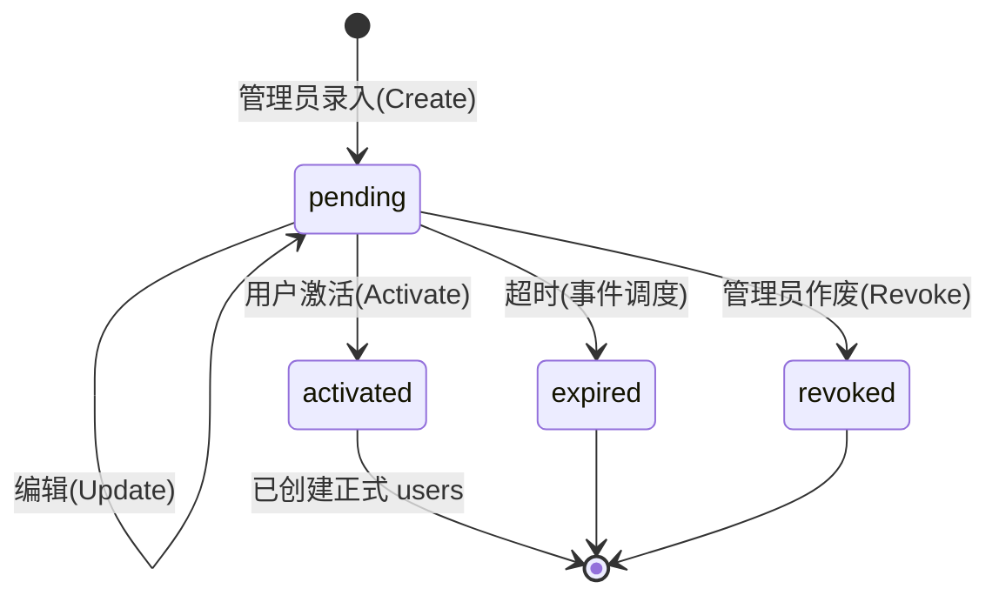

# 数据库设计文档

> 版本：v2.1（2026-08-11）
> 定位：**基于现有表结构的增量优化**（索引 / 唯一约束 / 外键 / 触发器 / 存储过程 / 事件调度），不改变既有业务模型与角色体系。
> 适用 MySQL 8.0+（CHECK 约束、JSON_TABLE）。
> 原则：并发与数据维护下沉数据库层；应用层只做校验与编排。

---

## 1. 现状评估（优化出发点）

现有表来自 `backend/internal/service/system.go` 建表 SQL + `migrations/003~010`，共 **15 张**。现状问题集中在**运行效率与数据完整性**，非功能缺陷：

| # | 问题 | 位置 | 影响 |
|---|---|---|---|
| 1 | `duty_records` **无唯一约束** | 同用户同时间格可重复写入 | 重复排班、统计虚高 |
| 2 | `schedule_settings` **无唯一键**，但 DAO 依赖 `ON DUPLICATE KEY UPDATE` | `admin_id` 只是普通索引 | 多管理员各自保存 → **累积多行**，`ORDER BY id DESC LIMIT 1` 只能兜底（真实 bug） |
| 3 | 高频查询**缺复合索引** | `applications`、`user_permissions_temp`、`duty_records` | 待办审批/我的申请/接口鉴权/个人周排班走全表 |
| 4 | `password_reset_tokens.token` 仅普通索引 | | 无法防重放 |
| 5 | `users` 无任职状态字段 | `is_active` 只承担账号禁用 | 无法表达在职/离职 |
| 6 | 值班次数无冗余，`COUNT(*)` 实时聚合 | `DutyDAO.BatchCountBy*` | 排班均衡/统计高频 GROUP BY |
| 7 | `user_permissions_temp.expires_at` 表允许 NULL（system.go 版），model 是非指针 `time.Time` | | 遇到 NULL `Scan` 报错（类型不一致） |
| 8 | 排班确认"先删整周再批量插"**无事务** | `ConfirmSchedule`（DeleteByWeek + CreateBatch） | 中途失败留半截数据 |
| 9 | 过期临时权限/令牌**无清理机制** | `CleanupExpiredPermissions` 依赖手动触发 | 数据膨胀、接口鉴权扫描变慢 |
| 10 | 大量写入用普通 `INSERT`，非幂等 | `DutyDAO.CreateBatch`、`AvailabilityDAO.CreateBatch` | 重复导入整批失败 |

**未改动（保留现有设计）**：
- 角色体系：`users.role` + `users.dept_role`（见 §3）
- 部门用**硬编码字符串**（办公室/竞赛部/项目部/科普部），`model.DepartmentID()` 映射，**不引入 departments 表**
- 申请审批流四表及状态机
- `availability` 已有的 `uk_avail` 唯一约束与 `idx_time_user`

---

## 2. 表清单（共 16 张 = 现有 15 − 1 + 新增 2）

| # | 表名 | 变更 |
|---|---|---|
| 1 | `system_config` | 无 |
| 2 | `users` | **变更**：+ `employment_status`、`joined_at`、`left_at`、`duty_count` |
| 3 | `availability` | 无（已有 uk_avail / idx_time_user / FK） |
| 4 | `duty_records` | **变更**：+ 唯一约束 `uk_duty_cell`、+ 索引 `idx_user_week`、+ CHECK |
| 5 | ~~duty_counters~~ | **删除**，并入 `users.duty_count`（触发器维护） |
| 6 | `schedule_settings` | **变更**：+ `config_key` 唯一键（单例化） |
| 7 | `export_templates` | 无 |
| 8 | `weekly_duty_assignments` | 无 |
| 9 | `user_permissions_temp` | **变更**：+ 复合索引、+ 外键、`expires_at` 统一 NULL 默认 |
| 10 | `smtp_config` | 无 |
| 11 | `password_reset_tokens` | **变更**：+ `token` 唯一索引、+ 外键 |
| 12 | `application_types` | 无 |
| 13 | `applications` | **变更**：+ 复合索引、+ 外键 |
| 14 | `application_approvals` | **变更**：+ 外键 |
| 15 | `application_approvers` | **变更**：+ 外键 |
| 16 | `leave_requests` | **新增**（请假，复用审批流） |
| 17 | `user_invitations` | **新增**（预注册待激活账号） |

---

## 3. 角色与权限体系（现有设计，保持不变）

> 关键点：**一个部门可以有多个管理员**。`dept_role` 是每用户字段，任意多用户可同时为 `dept_admin`，不存在"一个部门仅一个管理员"的限制。

### 3.1 角色解析（`auth.ResolveRole`）

```
users.role = 'admin'                                        → 系统管理员（全部权限，Checker 短路）
users.department = '办公室' AND dept_role = 'dept_admin'     → 办公室管理员 office_admin
users.dept_role = 'dept_admin'                               → 部门管理员（可多个，per 部门）
users.dept_role = 'dept_member'                              → 部门成员
其他                                                         → 普通用户 user
```

> 说明：`office_admin` 是**派生身份**而非存储角色（`users.role` 仅允许 `admin/user`），
> 由鉴权层按上述组合规则附加全局权限集（见 `auth/roles.go` 的 `officeAdminPermissions`）。
> `application_approvers.role_type` 中的 `'office_admin'` 是审批流角色类型
> （匹配"办公室部门的部门管理员"），与用户存储角色无关。

### 3.2 权限模型

- 权限来源 = **角色权限**（`auth.RolePermissions` 映射表）∪ **临时权限**（`user_permissions_temp`）
- 部门级权限（`deptScopedPermissions`）自动限定资源范围为**用户所在部门**（`resource_type=dept, resource_id=DepartmentID(department)`）
- 权限组传递展开（`schedule:manage:all` → `schedule:manage:dept` → ...）由 `permImplies` 处理
- 部门硬编码映射：办公室=1、竞赛部=2、项目部=3、科普部=4（`model.DepartmentID`）

---

## 4. ER 图

```mermaid
erDiagram
    USERS ||--o{ AVAILABILITY : "user_id 无课表"
    USERS ||--o{ DUTY_RECORDS : "user_id 值班人"
    USERS ||--o{ DUTY_RECORDS : "assigned_by 排班人"
    USERS ||--o{ LEAVE_REQUESTS : "请假"
    USERS ||--o{ USER_PERMISSIONS_TEMP : "user_id 被授权人"
    USERS ||--o{ USER_PERMISSIONS_TEMP : "granted_by 授权人"
    USERS ||--o{ APPLICATIONS : "applicant_id 申请人"
    USERS ||--o{ APPLICATION_APPROVALS : "approver_id 审批人"
    USERS ||--o{ APPLICATION_APPROVERS : "specific_user_id 指定审批人"
    USERS ||--o{ PASSWORD_RESET_TOKENS : "user_id"
    USERS ||--o{ USER_INVITATIONS : "created_by 录入人"
    USERS ||--o{ USER_INVITATIONS : "activated_user_id 激活后关联"
    APPLICATION_TYPES ||--o{ APPLICATIONS : "type_code 申请类型"
    APPLICATIONS ||--o{ APPLICATION_APPROVALS : "审批历史"
    APPLICATIONS ||--o{ LEAVE_REQUESTS : "application_id 审批关联"
    SCHEDULE_SETTINGS ||--o| USERS : "admin_id 最后修改人"
    EXPORT_TEMPLATES ||--o| USERS : "admin_id 创建人"
    WEEKLY_DUTY_ASSIGNMENTS ||--o| USERS : "created_by 发布人"

    USERS {
        int id PK
        string student_id UK "学号"
        string name
        string email UK
        string password
        string role "admin/user"
        string department "部门名(硬编码: 办公室/竞赛部/项目部/科普部)"
        string dept_role "dept_admin/dept_member 多管理员支持"
        string employment_status "★新增 active/resigned/leave"
        date joined_at "★新增 入职日期"
        date left_at "★新增 离职日期"
        int duty_count "★新增 值班次数(触发器维护)"
        bool is_active "账号禁用(软删除)"
        timestamp created_at
        timestamp updated_at
    }
    AVAILABILITY {
        int id PK
        int user_id FK "→users CASCADE"
        tinyint week "1-30 CHECK"
        tinyint weekday "1-5 CHECK"
        tinyint period "1-4 CHECK"
        timestamp created_at
        string uk_avail UK "user_id+week+weekday+period"
        string idx_time_user "week+weekday+period+user_id"
    }
    DUTY_RECORDS {
        int id PK
        tinyint week "1-30 CHECK"
        tinyint weekday "1-5 CHECK"
        tinyint period "1-4 CHECK"
        int user_id FK "值班人→users CASCADE"
        string department "部门快照"
        int assigned_by FK "排班人→users SET NULL"
        string status "pending/confirmed/completed/cancelled"
        string remark
        timestamp created_at
        timestamp updated_at
        string uk_duty_cell UK "★新增 week+weekday+period+user_id"
        string idx_user_week "★新增 user_id+week"
    }
    LEAVE_REQUESTS {
        int id PK
        int application_id FK "→applications 审批单"
        int user_id FK "请假人→users"
        string leave_type "sick/personal/annual"
        date start_date
        date end_date
        string status "pending/approved/rejected"
        string reason
        timestamp created_at
        timestamp updated_at
        string idx_user_date "user_id+start_date+end_date 排班联动"
    }
    SCHEDULE_SETTINGS {
        int id PK
        string config_key UK "★新增 单例键='global'"
        int admin_id FK "最后修改人→users"
        int current_week
        bool auto_increment
        int need_per_cell
        int min_per_cell
        int max_per_day
        int max_per_week
        string export_title
        date semester_start_date
        timestamp created_at
        timestamp updated_at
    }
    USER_PERMISSIONS_TEMP {
        int id PK
        int user_id FK "被授权人→users CASCADE"
        string permission
        string resource_type "all/dept/user"
        int resource_id
        int granted_by FK "授权人→users"
        string reason
        timestamp expires_at "NULL=永久"
        bool is_active
        timestamp created_at
        string idx_user_perm_active "★新增 user_id+permission+is_active"
    }
    APPLICATIONS {
        int id PK
        string application_no UK
        string type_code FK "→application_types"
        int applicant_id FK "申请人→users"
        string department
        string title
        text content
        json data
        int status "0待审批1审批中2通过3拒绝4撤回"
        int current_level
        int total_levels
        int approver_id FK "当前审批人→users"
        text result
        timestamp created_at
        timestamp updated_at
        string idx_status_type "★新增 status+type_code"
        string idx_applicant_status "★新增 applicant_id+status"
    }
    APPLICATION_APPROVALS {
        int id PK
        int application_id FK "→applications CASCADE"
        int level
        int approver_id FK "审批人→users"
        int action "1通过2拒绝3转办4评论"
        text comment
        json data
        timestamp created_at
    }
    APPLICATION_APPROVERS {
        int id PK
        string type_code
        int level
        string role_type "admin/dept_admin/office_admin/specific" // 审批角色类型，非用户存储角色
        int specific_user_id FK "→users"
        bool is_active
        timestamp created_at
        string uk_type_level UK "type_code+level"
    }
    PASSWORD_RESET_TOKENS {
        int id PK
        int user_id FK "→users CASCADE"
        string email
        string token UK "★新增 防重放"
        timestamp expires_at
        bool is_used
        timestamp created_at
    }
    USER_INVITATIONS {
        int id PK
        string student_id UK "学号"
        string name
        string email
        string department
        string dept_role
        string token UK "激活令牌(SHA-256哈希)"
        timestamp token_expires_at "过期时间(录入+7天)"
        string status "pending/activated/expired/revoked"
        int created_by FK "录入人→users"
        timestamp activated_at
        int activated_user_id FK "→users 激活后关联"
        timestamp created_at
        string idx_status "status+token_expires_at 过期扫描"
    }
```

> 注：`system_config`、`smtp_config`、`export_templates`、`weekly_duty_assignments`、`application_types` 结构不变，未在图中重复。

---

## 5. 增量变更明细

### 5.1 `users`（扩展字段）

```sql
ALTER TABLE users
    ADD COLUMN employment_status ENUM('active','resigned','leave') NOT NULL DEFAULT 'active'
        COMMENT '任职状态: 在职/离职/休假' AFTER dept_role,
    ADD COLUMN joined_at DATE NULL COMMENT '入职日期' AFTER employment_status,
    ADD COLUMN left_at DATE NULL COMMENT '离职日期' AFTER joined_at,
    ADD COLUMN duty_count INT NOT NULL DEFAULT 0 COMMENT '值班次数(触发器维护)' AFTER left_at;
-- 存量回填任职状态
UPDATE users SET employment_status = 'active' WHERE employment_status IS NULL;
```

- `employment_status` 与 `is_active`（账号禁用）**语义分离**，互不影响
- 离职联动由 `sp_mark_user_resigned` 负责（见 §7）；登录校验 `employment_status='active'`

### 5.2 `schedule_settings`（单例化，修复累积行 bug）

```sql
-- ① 保留最新一行，清理存量重复行
DELETE s1 FROM schedule_settings s1
JOIN schedule_settings s2
  ON s1.id < s2.id
 AND s1.admin_id <=> s2.admin_id;
-- ② 加单例键
ALTER TABLE schedule_settings
    ADD COLUMN config_key VARCHAR(20) NOT NULL DEFAULT 'global' COMMENT '单例键' AFTER id;
-- ③ 加唯一索引（ON DUPLICATE KEY UPDATE 依赖此键生效）
ALTER TABLE schedule_settings ADD UNIQUE KEY uk_config_key (config_key);
```

> 现有 `SaveScheduleSettings` / `UpdateCurrentWeek` / `UpdateSemesterStartDate` 的 `ON DUPLICATE KEY UPDATE` 语句**无需改 SQL**，靠 `uk_config_key` 即可正确去重（应用层需在 insert 中补 `config_key` 列）。

### 5.3 `duty_records`（唯一约束 + 索引 + CHECK）

```sql
-- ① 清理存量重复（保留最小 id）
DELETE d1 FROM duty_records d1
JOIN duty_records d2
  ON d1.week = d2.week AND d1.weekday = d2.weekday
 AND d1.period = d2.period AND d1.user_id = d2.user_id AND d1.id > d2.id;
-- ② 唯一约束 + 索引 + CHECK
ALTER TABLE duty_records
    ADD UNIQUE KEY uk_duty_cell (week, weekday, period, user_id),
    ADD KEY idx_user_week (user_id, week),
    ADD CONSTRAINT chk_duty_week CHECK (week BETWEEN 1 AND 30),
    ADD CONSTRAINT chk_duty_weekday CHECK (weekday BETWEEN 1 AND 5),
    ADD CONSTRAINT chk_duty_period CHECK (period BETWEEN 1 AND 4);
```

### 5.4 `availability`（补 CHECK，其余已有）

```sql
ALTER TABLE availability
    ADD CONSTRAINT chk_avail_week CHECK (week BETWEEN 1 AND 30),
    ADD CONSTRAINT chk_avail_weekday CHECK (weekday BETWEEN 1 AND 5),
    ADD CONSTRAINT chk_avail_period CHECK (period BETWEEN 1 AND 4);
```

### 5.5 `user_permissions_temp`（索引 + 外键 + 类型一致性）

```sql
ALTER TABLE user_permissions_temp
    ADD KEY idx_user_perm_active (user_id, permission, is_active),
    ADD CONSTRAINT fk_tp_user FOREIGN KEY (user_id) REFERENCES users(id) ON DELETE CASCADE,
    ADD CONSTRAINT fk_tp_granted_by FOREIGN KEY (granted_by) REFERENCES users(id);
-- expires_at 统一为 NULL 默认（model 同步改为 *time.Time，消除 Scan NULL 报错）
ALTER TABLE user_permissions_temp MODIFY expires_at TIMESTAMP NULL DEFAULT NULL;
```

### 5.6 `password_reset_tokens`（唯一索引 + 外键）

```sql
ALTER TABLE password_reset_tokens
    DROP INDEX idx_token,
    ADD UNIQUE KEY uk_token (token),
    ADD CONSTRAINT fk_prt_user FOREIGN KEY (user_id) REFERENCES users(id) ON DELETE CASCADE;
```

### 5.7 审批流三表（外键 + 复合索引）

```sql
ALTER TABLE applications
    ADD KEY idx_status_type (status, type_code),
    ADD KEY idx_applicant_status (applicant_id, status),
    ADD CONSTRAINT fk_app_type FOREIGN KEY (type_code) REFERENCES application_types(code),
    ADD CONSTRAINT fk_app_applicant FOREIGN KEY (applicant_id) REFERENCES users(id),
    ADD CONSTRAINT fk_app_approver FOREIGN KEY (approver_id) REFERENCES users(id);

ALTER TABLE application_approvals
    ADD CONSTRAINT fk_aprv_application FOREIGN KEY (application_id) REFERENCES applications(id) ON DELETE CASCADE,
    ADD CONSTRAINT fk_aprv_approver FOREIGN KEY (approver_id) REFERENCES users(id);

ALTER TABLE application_approvers
    ADD CONSTRAINT fk_aprver_specific FOREIGN KEY (specific_user_id) REFERENCES users(id);
```

> 审批历史/审批人关联用户删除：`application_approvals` 为 append-only 历史，故 approver 用默认 RESTRICT，防止误删。

### 5.8 `duty_counters` 删除

```sql
DROP TABLE IF EXISTS duty_counters;
-- 存量回填 users.duty_count（口径：status != 'cancelled'）
UPDATE users u SET duty_count = (
    SELECT COUNT(*) FROM duty_records dr
    WHERE dr.user_id = u.id AND dr.status <> 'cancelled');
```

### 5.9 新增 `leave_requests` 请假表

```sql
CREATE TABLE IF NOT EXISTS leave_requests (
    id INT PRIMARY KEY AUTO_INCREMENT,
    application_id INT NOT NULL COMMENT '关联审批单',
    user_id INT NOT NULL COMMENT '请假人',
    leave_type ENUM('sick','personal','annual') NOT NULL COMMENT '请假类型',
    start_date DATE NOT NULL COMMENT '开始日期',
    end_date DATE NOT NULL COMMENT '结束日期',
    status ENUM('pending','approved','rejected') NOT NULL DEFAULT 'pending' COMMENT '状态',
    reason VARCHAR(255) COMMENT '请假原因',
    created_at TIMESTAMP DEFAULT CURRENT_TIMESTAMP,
    updated_at TIMESTAMP DEFAULT CURRENT_TIMESTAMP ON UPDATE CURRENT_TIMESTAMP,
    UNIQUE KEY uk_application (application_id),
    KEY idx_user_date (user_id, start_date, end_date),
    CONSTRAINT fk_leave_application FOREIGN KEY (application_id) REFERENCES applications(id) ON DELETE CASCADE,
    CONSTRAINT fk_leave_user FOREIGN KEY (user_id) REFERENCES users(id) ON DELETE CASCADE,
    CONSTRAINT chk_leave_date CHECK (end_date >= start_date)
) ENGINE=InnoDB COMMENT='请假表';
```

### 5.10 新增 `user_invitations` 预注册表

```sql
CREATE TABLE IF NOT EXISTS user_invitations (
    id INT PRIMARY KEY AUTO_INCREMENT,
    student_id VARCHAR(20) NOT NULL COMMENT '学号',
    name VARCHAR(50) NOT NULL COMMENT '姓名',
    email VARCHAR(100) NOT NULL COMMENT '邮箱',
    department VARCHAR(50) NOT NULL DEFAULT '科普部' COMMENT '部门',
    dept_role ENUM('dept_admin','dept_member') NOT NULL DEFAULT 'dept_member' COMMENT '部门角色',
    token VARCHAR(64) NOT NULL COMMENT '激活令牌(SHA-256哈希)',
    token_expires_at TIMESTAMP NOT NULL COMMENT '过期时间',
    status ENUM('pending','activated','expired','revoked') NOT NULL DEFAULT 'pending' COMMENT '状态',
    created_by INT NOT NULL COMMENT '录入人',
    activated_at TIMESTAMP NULL COMMENT '激活时间',
    activated_user_id INT NULL COMMENT '激活后关联的正式用户',
    created_at TIMESTAMP DEFAULT CURRENT_TIMESTAMP,
    UNIQUE KEY uk_token (token),
    UNIQUE KEY uk_student_id (student_id),
    KEY idx_status (status, token_expires_at),
    CONSTRAINT fk_inv_created_by FOREIGN KEY (created_by) REFERENCES users(id),
    CONSTRAINT fk_inv_activated FOREIGN KEY (activated_user_id) REFERENCES users(id) ON DELETE SET NULL
) ENGINE=InnoDB COMMENT='预注册待激活账号表';
```

---

## 6. 触发器 —— `users.duty_count` 自动维护

### 6.1 策略

| 方案 | 一致性 | 读性能 | 写开销 | 结论 |
|---|---|---|---|---|
| 读时 `COUNT(*)` 聚合 | 天然一致 | 差（排班均衡/统计高频 GROUP BY） | 无 | ✗ |
| **触发器同步** | 数据库保证 | O(1) 直接读 | 低频、可忽略 | **✓ 采用** |

### 6.2 定义

```sql
CREATE TRIGGER trg_duty_count_ai AFTER INSERT ON duty_records FOR EACH ROW
IF NEW.status <> 'cancelled' THEN
    UPDATE users SET duty_count = duty_count + 1, updated_at = NOW() WHERE id = NEW.user_id;
END IF;

CREATE TRIGGER trg_duty_count_ad AFTER DELETE ON duty_records FOR EACH ROW
IF OLD.status <> 'cancelled' THEN
    UPDATE users SET duty_count = duty_count - 1, updated_at = NOW() WHERE id = OLD.user_id;
END IF;

CREATE TRIGGER trg_duty_count_au AFTER UPDATE ON duty_records FOR EACH ROW
IF (OLD.status <> 'cancelled') <> (NEW.status <> 'cancelled') THEN
    UPDATE users SET duty_count = duty_count + IF(NEW.status <> 'cancelled', 1, -1),
           updated_at = NOW() WHERE id = NEW.user_id;
END IF;
```

### 6.3 保护

- 触发器在行锁内执行，`sp_confirm_schedule` 删除+插入同一事务，计数不漂移
- `sp_confirm_schedule` 增加守卫：该周存在 `confirmed/completed` 记录时 `SIGNAL` 拒绝重排（防止已确认班次被替换导致计数错误）

---

## 7. 存储过程（事务下沉数据库）

### 7.1 `sp_confirm_schedule` 排班确认（原子替换整周）

```sql
CREATE PROCEDURE sp_confirm_schedule(IN p_week INT, IN p_admin_id INT, IN p_cells JSON)
BEGIN
    DECLARE EXIT HANDLER FOR SQLEXCEPTION BEGIN ROLLBACK; RESIGNAL; END;
    START TRANSACTION;
    IF EXISTS(SELECT 1 FROM duty_records
              WHERE week = p_week AND status IN ('confirmed','completed')) THEN
        SIGNAL SQLSTATE '45000' SET MESSAGE_TEXT = '该周已有已确认或完成的排班，禁止重排';
    END IF;
    DELETE FROM duty_records WHERE week = p_week;
    INSERT INTO duty_records (week, weekday, period, user_id, department, assigned_by, status)
    SELECT p_week, jt.weekday, jt.period, ju.user_id, u.department, p_admin_id, 'pending'
    FROM JSON_TABLE(p_cells, '$[*]' COLUMNS (
        weekday INT PATH '$.weekday', period INT PATH '$.period',
        user_ids JSON PATH '$.user_ids')) jt
    CROSS JOIN JSON_TABLE(jt.user_ids, '$[*]' COLUMNS (user_id INT PATH '$')) ju
    JOIN users u ON u.id = ju.user_id;
    COMMIT;
END;
```

### 7.2 `sp_activate_invitation` 预注册激活（事务 + 行锁防并发）

```sql
CREATE PROCEDURE sp_activate_invitation(IN p_token_hash VARCHAR(64), IN p_password_hash VARCHAR(255))
BEGIN
    DECLARE EXIT HANDLER FOR SQLEXCEPTION BEGIN ROLLBACK; RESIGNAL; END;
    START TRANSACTION;
    SELECT id INTO @inv_id FROM user_invitations
        WHERE token = p_token_hash AND status = 'pending' FOR UPDATE;
    IF @inv_id IS NULL THEN
        SIGNAL SQLSTATE '45000' SET MESSAGE_TEXT = '令牌无效或已使用';
    END IF;
    IF (SELECT token_expires_at FROM user_invitations WHERE id = @inv_id) < NOW() THEN
        SIGNAL SQLSTATE '45000' SET MESSAGE_TEXT = '令牌已过期';
    END IF;
    IF EXISTS(SELECT 1 FROM users WHERE student_id=(SELECT student_id FROM user_invitations WHERE id=@inv_id))
       OR EXISTS(SELECT 1 FROM users WHERE email=(SELECT email FROM user_invitations WHERE id=@inv_id)) THEN
        SIGNAL SQLSTATE '45000' SET MESSAGE_TEXT = '学号或邮箱已被注册';
    END IF;
    INSERT INTO users (student_id, name, email, password, department, dept_role,
                       employment_status, duty_count, is_active)
    SELECT student_id, name, email, p_password_hash, department, dept_role,
           'active', 0, 1 FROM user_invitations WHERE id = @inv_id;
    UPDATE user_invitations
        SET status='activated', activated_at=NOW(), activated_user_id=LAST_INSERT_ID()
        WHERE id = @inv_id;
    COMMIT;
END;
```

### 7.3 `sp_mark_user_resigned` 离职处理

```sql
CREATE PROCEDURE sp_mark_user_resigned(IN p_user_id INT, IN p_admin_id INT, IN p_left_at DATE)
BEGIN
    DECLARE EXIT HANDLER FOR SQLEXCEPTION BEGIN ROLLBACK; RESIGNAL; END;
    START TRANSACTION;
    UPDATE users SET employment_status = 'resigned', left_at = p_left_at WHERE id = p_user_id;
    UPDATE duty_records SET status = 'cancelled'
        WHERE user_id = p_user_id AND status = 'pending';
    UPDATE user_permissions_temp SET is_active = 0
        WHERE user_id = p_user_id AND is_active = 1;
    COMMIT;
END;
```

### 7.4 `sp_approve_leave` 请假批准联动

```sql
CREATE PROCEDURE sp_approve_leave(IN p_application_id INT, IN p_week_start DATE)
BEGIN
    DECLARE EXIT HANDLER FOR SQLEXCEPTION BEGIN ROLLBACK; RESIGNAL; END;
    START TRANSACTION;
    UPDATE leave_requests SET status = 'approved' WHERE application_id = p_application_id;
    -- 将请假期内该用户已有排班置为 cancelled（week/weekday → 日期：p_week_start 为学期起始日）
    UPDATE duty_records dr
    JOIN leave_requests lr ON lr.application_id = p_application_id AND lr.user_id = dr.user_id
    SET dr.status = 'cancelled', dr.updated_at = NOW()
    WHERE dr.status IN ('pending', 'confirmed')
      AND DATE_ADD(p_week_start, INTERVAL (dr.week - 1) * 7 + (dr.weekday - 1) DAY)
          BETWEEN lr.start_date AND lr.end_date;
    COMMIT;
END;
```

> `p_week_start` 取 `schedule_settings.semester_start_date`。排班候选查询另需排除请假中用户（`leave_requests` 状态 `approved` 且日期区间覆盖该周）。

---

## 8. 事件调度（周期清理）

```sql
CREATE EVENT evt_cleanup_expired
ON SCHEDULE EVERY 1 HOUR
DO BEGIN
    UPDATE user_permissions_temp SET is_active = 0 WHERE expires_at < NOW() AND is_active = 1;
    UPDATE user_invitations SET status = 'expired' WHERE token_expires_at < NOW() AND status = 'pending';
    DELETE FROM password_reset_tokens WHERE expires_at < NOW() OR is_used = 1;
END;
```

需开启并固化：`SET GLOBAL event_scheduler = ON`（写入 `docker-compose.yml` / `my.cnf`）。

---

## 9. 激活令牌 CRUD（`user_invitations`）

### 9.1 状态机



### 9.2 操作定义

| 操作 | 接口 | 权限 | 规则 |
|---|---|---|---|
| **Create** 录入 | `POST /admin/invitations` | `user:manage` | 校验学号/邮箱在 `users` 与既有邀请中均未占用；32 字节 CSPRNG → 存 SHA-256 哈希；`token_expires_at = NOW()+7天`；`status=pending`；SMTP 发激活链接 |
| **List / Get** | `GET /admin/invitations` `GET /:id` | `user:manage` | 按 `status`/`department` 筛选 + 分页 |
| **Validate** 校验 | `GET /invitations/validate?token=` | 公开 | 仅校验有效性：`pending` 且未过期 → 返回脱敏预填信息；否则返回原因 |
| **Update** 编辑 | `PUT /admin/invitations/:id` | `user:manage` | **仅 `pending` 可编辑**；改邮箱须重新查重 |
| **Revoke** 作废 | `POST /admin/invitations/:id/revoke` | `user:manage` | `pending → revoked`，保留记录追溯 |
| **Delete** 删除 | `DELETE /admin/invitations/:id` | `user:manage` | **仅 `pending`** 可物理删除；已激活因 FK 关联禁止 |
| **Activate** 激活 | `POST /invitations/activate` | 公开 | `{token, password}` → `sp_activate_invitation` |

### 9.3 安全要点

- **令牌**：存 SHA-256 哈希（激活链接暴露面大），查询先哈希再比对
- **幂等**：`SELECT ... FOR UPDATE` 行锁 + `status='pending'` 校验，同一令牌并发仅一个成功
- **注册开关**：`system_config.allow_public_register`（默认 'true'）关闭后，`Register` 必须携带有效激活令牌

---

## 10. 应用层改动对照（Go 侧最小改动）

| 现有代码 | 改造 |
|---|---|
| `ConfirmSchedule`：`DeleteByWeek` + `CreateBatch` 无事务 | 调 `sp_confirm_schedule` |
| `DutyDAO.CreateBatch` / `AvailabilityDAO.CreateBatch` 普通 INSERT | `INSERT IGNORE`（唯一约束幂等） |
| `SaveScheduleSettings` 系列 upsert | insert 补 `config_key='global'`，`ON DUPLICATE KEY UPDATE` 靠 `uk_config_key` 生效 |
| `UserPermissionTemp.ExpiresAt time.Time` | 改 `*time.Time`（适配 NULL） |
| 审批流 `UpdateStatusWithCheck`（乐观锁） | **保留**（单条 SQL 已原子），仅联动下沉 |
| 无 leave executor | 注册 `leave` executor：`OnApproved` 调 `sp_approve_leave` |
| 无邀请/离职服务 | 新增服务调 `sp_activate_invitation` / `sp_mark_user_resigned` |
| 登录仅查 `is_active` | 增加 `employment_status='active'` 校验 |
| 临时权限清理依赖手动 | 事件调度 `evt_cleanup_expired` 自动 |

---

## 11. 迁移脚本规划

| 脚本 | 内容 |
|---|---|
| `011_optimize_schema.sql` | 存量去重（保留最小 id）→ 唯一约束（uk_duty_cell / uk_config_key / uk_token）→ CHECK → 补外键 → `users` 扩展字段 + 回填 `duty_count` → `user_permissions_temp.expires_at` 统一 NULL → 删除 `duty_counters` |
| `012_add_hr_tables.sql` | 新建 `leave_requests`、`user_invitations` |
| `013_add_db_logic.sql` | 触发器（trg_duty_count_*） + 存储过程（sp_*） + 事件（evt_cleanup_expired） |
| `system.go` 同步 | 全新安装建表 SQL 同步上述结构（含新表 + 新字段 + 触发器/存储过程/事件注册），保证新旧安装一致 |
